<!-- ============================================================
     ENCABEZADO (rúbrica: universidad, asignatura, paralelo, integrantes, fecha)
     ============================================================ -->

# ESCUELA POLITÉCNICA NACIONAL
### Facultad de Ingeniería de Sistemas

**Asignatura:** Business Intelligence
**Paralelo:** _[Completar]_

## Práctica 1. Implementación de un proceso ETL y Staging Area con Pentaho Data Integration

**Integrantes:**
- Alvaro Montalvan
- Ruben Cuenca
- Jonathan Cuasapaz
- Ruben Cuenca

**Fecha:** _[10/10/2026]_

---

<!-- ============================================================
     ÍNDICE CON HIPERVÍNCULOS (rúbrica)
     Si cambian un título, actualicen también el ancla del enlace.
     ============================================================ -->

## Índice

- [ESCUELA POLITÉCNICA NACIONAL](#escuela-politécnica-nacional)
    - [Facultad de Ingeniería de Sistemas](#facultad-de-ingeniería-de-sistemas)
  - [Práctica 1. Implementación de un proceso ETL y Staging Area con Pentaho Data Integration](#práctica-1-implementación-de-un-proceso-etl-y-staging-area-con-pentaho-data-integration)
  - [Índice](#índice)
  - [Índice de figuras](#índice-de-figuras)
  - [Índice de tablas](#índice-de-tablas)
  - [1. Objetivo del proceso](#1-objetivo-del-proceso)
  - [2. Fuentes de datos utilizadas](#2-fuentes-de-datos-utilizadas)
  - [3. Problemas encontrados en los datos](#3-problemas-encontrados-en-los-datos)
    - [3.1 Problemas en el archivo Excel (.xls)](#31-problemas-en-el-archivo-excel-xls)
    - [3.2 Problemas en el archivo JSON (.json)](#32-problemas-en-el-archivo-json-json)
    - [3.3 Problemas en el archivo CSV (.csv)](#33-problemas-en-el-archivo-csv-csv)
  - [4. Transformaciones aplicadas](#4-transformaciones-aplicadas)
    - [4.1 Transformaciones sobre el Excel](#41-transformaciones-sobre-el-excel)
      - [4.1.1 Corrección de nombres y apellidos](#411-corrección-de-nombres-y-apellidos)
      - [4.1.2 Validación de fechas](#412-validación-de-fechas)
    - [4.2 Transformaciones sobre el JSON](#42-transformaciones-sobre-el-json)
      - [4.2.1 Mapeo de valores](#421-mapeo-de-valores)
      - [4.2.2 Filtrar filas](#422-filtrar-filas)
    - [4.3 Transformaciones sobre el CSV](#43-transformaciones-sobre-el-csv)
      - [4.3.1 Estandarizacion de Fechas](#431-estandarizacion-de-fechas)
      - [4.3.2 Estandarización de montos](#432-estandarización-de-montos)
  - [5. Flujo ETL desarrollado](#5-flujo-etl-desarrollado)
    - [5.1 Diagrama Excel](#51-diagrama-excel)
    - [5.2 Diagrama JSON](#52-diagrama-json)
    - [5.3 Diagrama CSV](#53-diagrama-csv)
  - [6. Evidencia del resultado](#6-evidencia-del-resultado)
    - [6.1 Excel](#61-excel)
      - [6.1.1 Excel antes](#611-excel-antes)
      - [6.1.2 Excel después](#612-excel-después)
    - [6.2 JSON](#62-json)
      - [6.2.1 JSON antes](#621-json-antes)
      - [6.2.2 JSON después](#622-json-después)
    - [6.3 CSV](#63-csv)
      - [6.3.1 CSV antes](#631-csv-antes)
      - [6.3.2 CSV después](#632-csv-después)
  - [7. Relación con una arquitectura de Data Warehouse](#7-relación-con-una-arquitectura-de-data-warehouse)
  - [8. Conclusiones](#8-conclusiones)
  - [9. Referencias bibliográficas](#9-referencias-bibliográficas)
  - [10. Declaración de uso de Inteligencia Artificial](#10-declaración-de-uso-de-inteligencia-artificial)

---

## Índice de figuras

<!-- Numerar todas las figuras de forma correlativa. Cada figura debe tener: número, título y ser referenciada en el texto ("como se observa en la Figura X"). -->

| N.º | Título | Sección |
|-----|--------|---------|
| Figura 1a | Configuración de String operations (limpieza de nombres y apellidos) | [4.1.1](#411-corrección-de-nombres-y-apellidos) |
| Figura 1b | Configuración de Replace in string (corrección de caracteres) | [4.1.1](#411-corrección-de-nombres-y-apellidos) |
| Figura 2a | Configuración de Replace in string (normalización de fechas) | [4.1.2](#412-validación-de-fechas) |
| Figura 2b | Configuración de Select values (conversión a tipo fecha) | [4.1.2](#412-validación-de-fechas) |
| Figura 2c | Configuración de Filter rows (validación de fechas) | [4.1.2](#412-validación-de-fechas) |
| Figura 3 | Configuración de Mapeo de valores en Pentaho | [4.2.1](#421-mapeo-de-valores) |
| Figura 4 | Configuración de Filtrar Filas en Pentaho | [4.2.2](#422-filtrar-filas) |
| Figura 5 | Configuración de _[transformación 1]_ en Pentaho (CSV) | [4.3.1](#431-transformación-1) |
| Figura 6 | Configuración de _[transformación 2]_ en Pentaho (CSV) | [4.3.2](#432-transformación-2) |
| Figura 7 | Flujo ETL Excel | [5.1](#51-diagrama-excel) |
| Figura 8 | Flujo ETL JSON | [5.2](#52-diagrama-json) |
| Figura 9 | Flujo ETL CSV | [5.3](#53-diagrama-csv) |
| Figura 10 | Datos Excel antes de la transformación | [6.1.1](#611-excel-antes) |
| Figura 11 | Datos Excel después de la transformación | [6.1.2](#612-excel-después) |
| Figura 12 | Datos JSON antes de la transformación | [6.2.1](#621-json-antes) |
| Figura 13 | Datos JSON después de la transformación | [6.2.2](#622-json-después) |
| Figura 14 | Datos CSV antes de la transformación | [6.3.1](#631-csv-antes) |
| Figura 15 | Datos CSV después de la transformación | [6.3.2](#632-csv-después) |
| Figura 16 | Arquitectura de Data Warehouse y ubicación del proceso desarrollado | [7](#7-relación-con-una-arquitectura-de-data-warehouse) |

## Índice de tablas

| N.º | Título | Sección |
|-----|--------|---------|
| Tabla 1 | Resumen de las fuentes de datos utilizadas | [2](#2-fuentes-de-datos-utilizadas) |
| Tabla 2 | Problemas de calidad de datos en el archivo Excel | [3.1](#31-problemas-en-el-archivo-excel-xls) |
| Tabla 3 | Problemas de calidad de datos en el archivo JSON | [3.2](#32-problemas-en-el-archivo-json-json) |
| Tabla 4 | Problemas de calidad de datos en el archivo CSV | [3.3](#33-problemas-en-el-archivo-csv-csv) |
| Tabla 5 | Declaración de uso de IA | [10](#10-declaración-de-uso-de-inteligencia-artificial) |

---

## 1. Objetivo del proceso

Diseñar y ejecutar con Pentaho Data Integration (Spoon) un proceso de Excract, Transform, Load que extraiga datos desde tres fuentes de formatos distintos (un archivo Excel de estudiantes, un archivo JSON de choques de vehículos de Nueva York y un archivo CSV de facturas), los prepare en una Staging Area y les aplique transformaciones de limpieza y estandarización, de modo que se obtengan datos consistentes y de calidad, listos para ser cargados en un Data Warehouse o Data Mart.

Para lograrlo se plantean los siguientes objetivos específicos:

- Extraer los datos originales de las fuentes Excel (.xls), JSON (.json) y CSV (.csv) mediante los pasos de entrada de Pentaho, y recibirlos en una Staging Area sin modificar la fuente.
- Identificar los problemas de calidad presentes en cada fuente, como nombres y apellidos con espacios o errores de escritura, fechas en formatos distintos o inválidas, etiquetas distintas para un mismo valor, causas sin especificar y montos con convenciones numéricas opuestas.
- Transformar los datos con operaciones de limpieza y estandarización: corrección de nombres y apellidos y validación de fechas en el Excel, mapeo de valores y filtrado de filas en el JSON, y unificación de fechas y de montos en el CSV.
- Cargar los datos procesados en archivos de salida (Excel, JSON y CSV), que representan el destino del proceso en esta práctica.
- Verificar la calidad y la consistencia de los resultados comparando los datos antes y después de la transformación.
- Relacionar el proceso desarrollado con los componentes de una arquitectura de Data Warehouse: fuentes de datos, Staging Area, transformación y destino.

---

## 2. Fuentes de datos utilizadas

**Tabla 1.** _Resumen de las fuentes de datos utilizadas._

| Fuente | Tipo / Formato | Origen | Descripción | N.º de registros | N.º de campos |
|--------|----------------|--------|-------------|------------------|---------------|
| Estudiantes.xls | Excel (.xls) | Archivo provisto en el aula virtual de la Escuela Politécnica Nacional| Registros de estudiantes con identificador, nombres, apellidos, cédula, modalidad, nivel, fecha de admisión, estado actual y fecha de estado. | 99 | 9 |
| h9gi-nx95.json | JSON | [NYC Motor Vehicle Collisions Dataset](https://data.cityofnewyork.us/resource/h9gi-nx95.json?select=collision_id,crash_date,borough,vehicle_type_code1,contributing_factor_vehicle_1,number_of_persons_injured&where=borough%20is%20not%20null&limit=2000&offset=300000) | Registros de choques de vehículos en la ciudad de Nueva York, obtenidos de la API de NYC Open Data. Cada registro tiene el identificador del choque, la fecha, el distrito (borough), el tipo de vehículo, el factor que contribuyó al choque y el número de personas heridas. | 2000 | 6 |
| messy-data-pack-1000.csv | CSV | [ExploreMyData](https://exploremydata.com/datasets/messy-data-pack) | Datos sucios de ejemplo para probar transformaciones. | 1000 | 7 |

---

## 3. Problemas encontrados en los datos

<!-- Identificar problemas de calidad: valores inconsistentes, mayúsculas/minúsculas, espacios, nulos, fechas inválidas, duplicados, formatos distintos, etc. -->

### 3.1 Problemas en el archivo Excel (.xls)

**Tabla 2.** _Problemas de calidad de datos en el archivo Excel._

| Campo | Descripción del problema |
|-------|--------------------------|
| NOMBRES | 15 registros tienen caracteres dañados por la codificación: la é aparece como `\|\|` (`Jos\|\|`, `In\|\|s`) y otras vocales acentuadas como `�` (`Ram�n`, `Mar�a`, `M�nica`). Además, 8 registros tienen espacios sobrantes (`Cecilia `, `Segundo  `) y algunos tienen minúsculas incorrectas (`Maria margarita`, `del transito`). |
| APELLIDOS | 16 registros tienen caracteres dañados: la ñ aparece como `~` (`Mu~oz`, `Pe~a`) y las vocales acentuadas como `�` (`D�az`, `L�pez`, `Ch�vez`). También hay 12 registros con apellidos en minúscula (`fierro`, `salazar`, `benavente`), 2 con espacios al final y 1 con doble espacio interno (`Biava  Gonzalez`). |
| FECHA ADMISION | Se lee como texto y no como fecha. 98 registros usan `yyyy/MM/dd HH:mm:ss.SSS`, pero el registro L000101 usa otro formato (`01/01/2010 0:00`). |
| FECHA ESTADO | Se lee como texto. El registro L000101 tiene un carácter basura al inicio y otro formato (`�12/06/2014`). No se había verificado que la fecha de estado fuera posterior a la de admisión. |

### 3.2 Problemas en el archivo JSON (.json)

**Tabla 3.** _Problemas de calidad de datos en el archivo JSON._

| Campo | Descripción del problema |
|-------|--------------------------|
| vehicle_type_code1 | Tiene demasiadas etiquetas sueltas para el mismo tipo de vehículo. Sedan y 4 dr sedan son lo mismo. PK es una abreviatura de Pick-up Truck. Dump y Tractor Truck Diesel son camiones.  |
| contributing_factor_vehicle_1 | Tiene el valor Unspecified que significa “no se sabe” y no es una causa real|

### 3.3 Problemas en el archivo CSV (.csv)

**Tabla 4.** _Problemas de calidad de datos en el archivo CSV._

| Campo | Descripción del problema |
|-------|--------------------------|
| date | Tiene cuatro formatos distintos en la misma columna: `2026-03-14` (250 registros), `03/14/2026` (250), `14.03.2026` (250) y `14 March 2026` (167). Esto impide ordenar, filtrar o convertir el campo a tipo fecha. |
| amount | Mezcla dos convenciones numéricas: estilo EE. UU. (`1,978.51`, 583 registros) y estilo europeo (`6.955,90`, 334 registros). La coma y el punto tienen significados opuestos, por lo que una lectura directa produciría montos erróneos. |

---

## 4. Transformaciones aplicadas

<!-- Requisitos:
     - Parte 1 (dataset provisto / Excel): corregir nombres y apellidos; validar fechas.
     - Parte 2: al menos dos transformaciones de limpieza o estandarización.
     Para cada transformación: nombre, descripción breve y captura de la configuración en Pentaho.
     Al poner el nombre real de la transformación, actualicen también el enlace en el Índice de figuras. -->

### 4.1 Transformaciones sobre el Excel

#### 4.1.1 Corrección de nombres y apellidos
Corrige los caracteres dañados por la codificación, elimina espacios sobrantes y unifica el uso de mayúsculas en los campos `NOMBRES` y `APELLIDOS`. Se aplicó en dos pasos, siempre sobrescribiendo los mismos campos:

1. **String operations** (carpeta Transform), paso `LIMPIAR NOMBRES`: elimina los espacios al inicio y al final (*Trim type = both*) y convierte la primera letra de cada palabra en mayúscula (*InitCap = Y*). Así `fierro Mu~oz` pasa a `Fierro Mu~oz`. Ver Figura 1a.
2. **Replace in string** (carpeta Transform), paso `CORREGIR NOMBRES`, con la opción *Use RegEx* activada. Ver Figura 1b. Se aplican reemplazos que:
   - convierten `||` en `é` y `~` en `ñ`;
   - restituyen las palabras con `�` (Ramón, María, Mónica, Julián, Tránsito, Alarcón, Díaz, Marín, López, Terán, Chávez, Román), usando `[^ -~]` para reconocer el carácter dañado sin teclearlo;
   - devuelven a minúscula las partículas `del`, `de` y `las`, que InitCap había puesto en mayúscula;
   - reducen a un solo espacio los dobles espacios internos.

| Valor original | Resultado |
|----------------|-----------|
| `Jos\|\| Luis` | `José Luis` |
| `Mar�a Ang\|\|lica` | `María Angélica` |
| `fierro Mu~oz` | `Fierro Muñoz` |
| `Biava  Gonzalez` | `Biava Gonzalez` |
| `Celia del transito` | `Celia del Tránsito` |

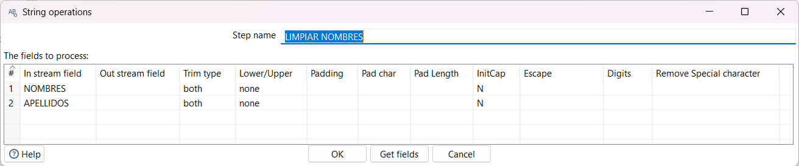
**Figura 1a.** _Configuración de String operations en Pentaho._

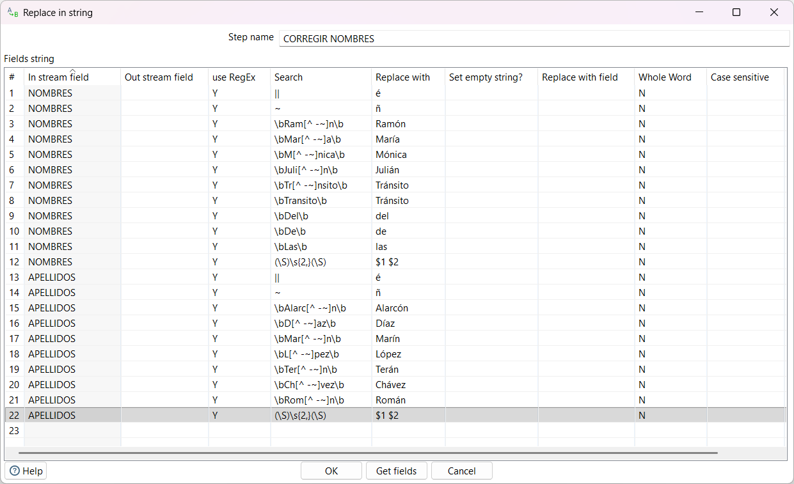
**Figura 1b.** _Configuración de Replace in string para corregir nombres y apellidos en Pentaho._

#### 4.1.2 Validación de fechas
Verifica que `FECHA ADMISION` y `FECHA ESTADO` sean fechas reales y coherentes. Los dos campos llegan como texto y un registro (L000101) tiene un formato distinto. La validación se hizo en tres pasos:

1. **Replace in string**, paso `NORMALIZAR FECHAS`: con una expresión regular, toma los valores con formato `dd/MM/yyyy` o `MM/dd/yyyy` (descartando el carácter basura inicial) y los reescribe como `yyyy/MM/dd 00:00:00.000`, el formato del resto de los registros. `12/06/2014` se interpretó como 6 de diciembre de 2014, siguiendo el patrón del registro vecino L000102. Ver Figura 2a.
2. **Select values** (pestaña Meta-data), paso `CONVERTIR FECHAS`: convierte ambos campos de texto a tipo *Date* con la máscara `yyyy/MM/dd HH:mm:ss.SSS` y *Date Format Lenient = N*. Una fecha inexistente produciría un error en este paso. Ver Figura 2b.
3. **Filter rows**, paso `VALIDAR FECHAS`: comprueba la regla de negocio `FECHA ESTADO >= FECHA ADMISION`. Los registros que la cumplen pasan a la salida y los demás se envían al paso `FECHAS INVALIDAS` (Dummy). Ver Figura 2c.

En la salida, las fechas se escriben con formato `yyyy-MM-dd`.

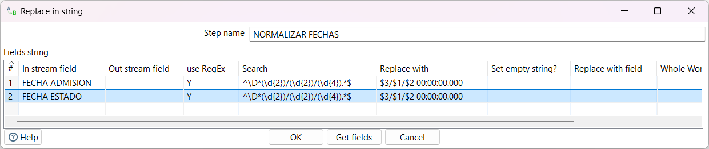
**Figura 2a.** _Configuración de Replace in string para normalizar fechas en Pentaho._

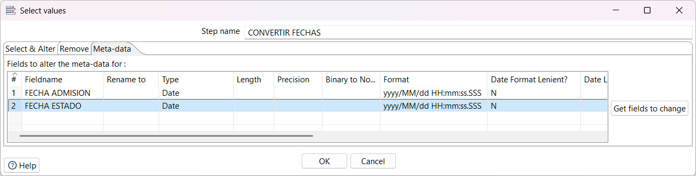
**Figura 2b.** _Configuración de Select values para convertir a tipo fecha en Pentaho._

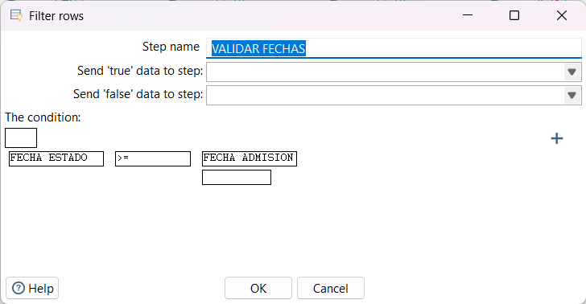
**Figura 2c.** _Configuración de Filter rows para validar fechas en Pentaho.__

### 4.2 Transformaciones sobre el JSON

#### 4.2.1 Mapeo de valores
Reemplaza los valores de un campo por otros, según una tabla de equivalencias definida.

Se aplicó sobre el campo `vehicle_type_code1`, sobrescribiendo el mismo campo, para agrupar las distintas etiquetas de un mismo tipo de vehículo en categorías estándar:

- **Sedan:** 4 dr sedan, Convertible
- **SUV:** Station Wagon/Sport Utility Vehicle, Carry All
- **Pickup:** Pick-up Truck, PK
- **Camión pesado:** Dump, Tractor Truck Diesel
- **Transporte público:** Taxi, Bus
- **Moto/Bici:** Motorcycle, E-Bike

Los valores que no están en la tabla (por ejemplo, "Sedan") se mantienen sin cambios.

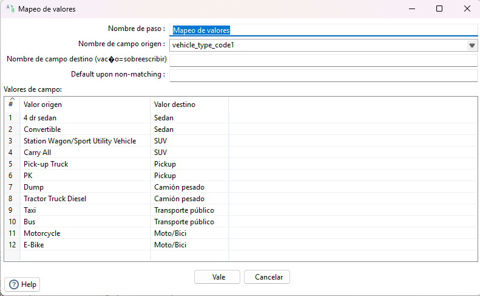
**Figura 3.** _Configuración de Mapeo de valores en Pentaho._

#### 4.2.2 Filtrar filas
Revisa cada fila con una condición y decide si pasa o se descarta.

Solo pasan al paso **JSON output** las filas que cumplen ambas condiciones:

- `contributing_factor_vehicle_1 <> Unspecified`: se descartan los choques cuya causa es desconocida.
- `vehicle_type_code1 IS NOT NULL`: se descartan los choques sin tipo de vehículo registrado.

Las filas que no cumplen la condición no se envían a ningún paso, por lo que se eliminan del resultado.

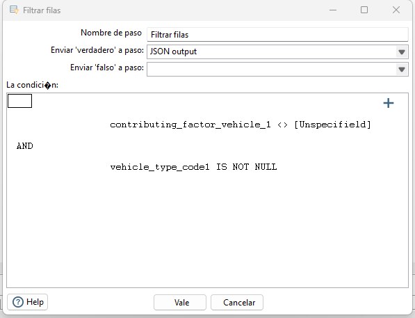
**Figura 4.** _Configuración de Filtrar Filas en Pentaho._

### 4.3 Transformaciones sobre el CSV

#### 4.3.1 Estandarizacion de Fechas
Unifica los cuatro formatos del campo `date` en el formato ISO `yyyy-MM-dd`. Se usó el paso **Replace in string** (carpeta Transform), que busca un texto en el campo y lo reemplaza por otro. Como se observa en la Figura 5, se configuraron tres reemplazos sobre el campo `date`, sobrescribiendo el mismo campo:

| Formato original | Buscar | Reemplazar por |
|------------------|--------|----------------|
| Estilo EE. UU. | `03/14/2026` | `2026-03-14` |
| Estilo con puntos | `14.03.2026` | `2026-03-14` |
| Texto con mes en inglés | `14 March 2026` | `2026-03-14` |

El formato `2026-03-14` ya era correcto, por lo que no requiere cambios. Como resultado, los 917 registros quedan con la misma fecha en formato `yyyy-MM-dd`.

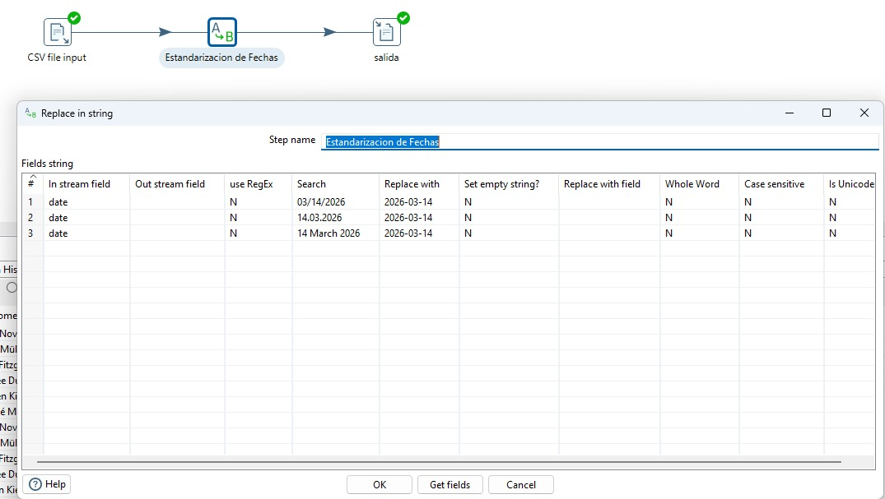
**Figura 5.** _Configuración de la estandarización de fechas en Pentaho._

#### 4.3.2 Estandarización de montos
Unifica los dos formatos del campo `amount` en un número con punto como separador decimal y sin separador de miles. Se usó nuevamente el paso **Replace in string** con la opción *Use RegEx* activada. Como se observa en la Figura 6, se aplican tres reemplazos en este orden:

1. Buscar `\.(?=\d{3}([.,]|$))` y reemplazar por vacío: elimina el punto de miles del formato europeo.
2. Buscar `,(?=\d{2}$)` y reemplazar por `.`: convierte la coma decimal europea en punto decimal.
3. Buscar `,` y reemplazar por vacío: elimina la coma de miles del formato EE. UU.

El orden es importante. Primero se retiran los puntos de miles, luego se convierte la coma decimal y al final se eliminan las comas de miles que quedan.

| Valor original | Formato | Resultado |
|----------------|---------|-----------|
| `1,978.51` | EE. UU. | `1978.51` |
| `6.955,90` | Europeo | `6955.90` |
| `2.637,12` | Europeo | `2637.12` |

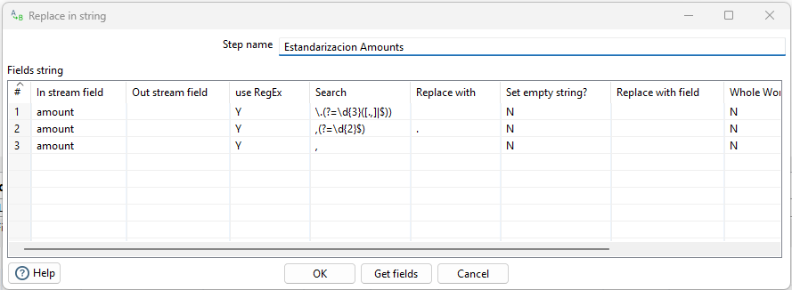
**Figura 6.** _Configuración de la estandarización de montosen Pentaho._

---

## 5. Flujo ETL desarrollado

### 5.1 Diagrama Excel
El flujo tiene siete pasos:

1. **Microsoft Excel input, `Staging` (Extract):** lee `Estudiantes.xls` y extrae los 9 campos.
2. **String operations, `LIMPIAR NOMBRES` (Transform):** elimina espacios y aplica mayúscula inicial en nombres y apellidos.
3. **Replace in string, `CORREGIR NOMBRES` (Transform):** corrige los caracteres dañados (`||`, `~`, `�`) y las partículas.
4. **Replace in string, `NORMALIZAR FECHAS` (Transform):** unifica el texto de las fechas al formato `yyyy/MM/dd HH:mm:ss.SSS`.
5. **Select values, `CONVERTIR FECHAS` (Transform):** convierte los dos campos de fecha a tipo *Date*.
6. **Filter rows, `VALIDAR FECHAS` (Transform):** deja pasar solo los registros con `FECHA ESTADO >= FECHA ADMISION`; el resto va al paso `FECHAS INVALIDAS` (Dummy).
7. **Microsoft Excel writer, `SALIDA ESTUDIANTES` (Load):** escribe los registros validados en `Resultado/Estudiantes_estandarizado.xlsx`.

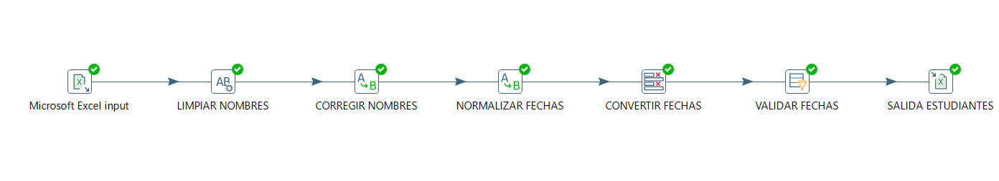
**Figura 7.** _Flujo ETL Excel._

### 5.2 Diagrama JSON
El flujo tiene cuatro pasos:

1. **JSON input (Extract):** lee el archivo `h9gi-nx95.json` y extrae los 6 campos.
2. **Mapeo de valores (Transform):** estandariza los tipos de vehículo en `vehicle_type_code1`.
3. **Filtrar filas (Transform):** descarta los registros con causa `Unspecified` o sin tipo de vehículo.
4. **JSON output (Load):** escribe los registros limpios en un nuevo archivo JSON.

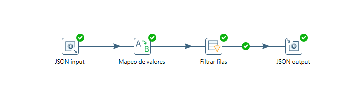
**Figura 8.** _Flujo ETL JSON._

### 5.3 Diagrama CSV
El flujo tiene cuatro pasos:

1. **Text file input (Extract):** lee el archivo `messy-data-pack-1000.csv` y extrae los 7 campos.
2. **Replace in string, montos (Transform):** unifica el campo `amount` a un número con punto decimal.
3. **Replace in string, fechas (Transform):** unifica el campo `date` al formato `yyyy-MM-dd`.
4. **Text file output (Load):** escribe los registros estandarizados en `datos_estandarizados.csv`.

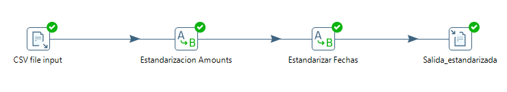
**Figura 9.** _Flujo ETL CSV._

---

## 6. Evidencia del resultado

<!-- Capturas de los datos antes y después de la transformación. -->

### 6.1 Excel
#### 6.1.1 Excel antes
Vista previa del paso de entrada con los datos originales. En `NOMBRES` y `APELLIDOS` aparecen caracteres dañados (`Mu~oz Molina`, `Ram�n`, `Alarc�n`), y en `FECHA ESTADO` el primer registro tiene un carácter basura y un formato distinto (`�12/06/2014`).

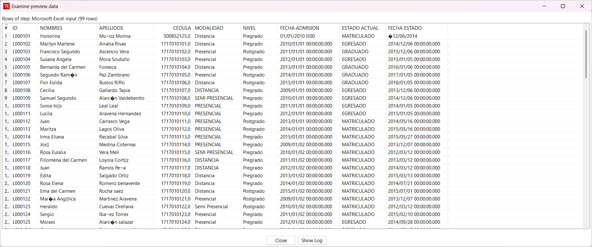
**Figura 10.** _Datos antes de la transformacion._

#### 6.1.2 Excel después
Contenido del archivo de salida `Estudiantes_estandarizado.xlsx`. Los nombres y apellidos quedan sin caracteres dañados ni espacios sobrantes, con la primera letra en mayúscula (`Muñoz Molina`, `Ramón`, `José`). Las fechas quedan en formato `yyyy-MM-dd`; por ejemplo, el registro L000101 muestra `2014-12-06`. Los 99 registros cumplieron la regla `FECHA ESTADO >= FECHA ADMISION` y el paso `FECHAS INVALIDAS` no recibió ninguno.

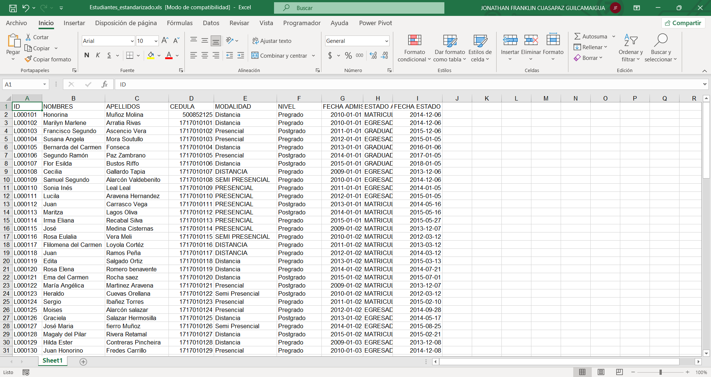
**Figura 11.** _Datos despues de la transformacion._

### 6.2 JSON
#### 6.2.1 JSON antes
Vista previa del paso JSON input con los datos originales. En `vehicle_type_code1` aparecen etiquetas distintas para un mismo tipo de vehículo, por ejemplo "Station Wagon/Sport Utility Vehicle", "Carry All", "4 dr sedan", "PK" o "Dump". En `contributing_factor_vehicle_1` hay muchos registros con valor "Unspecified".

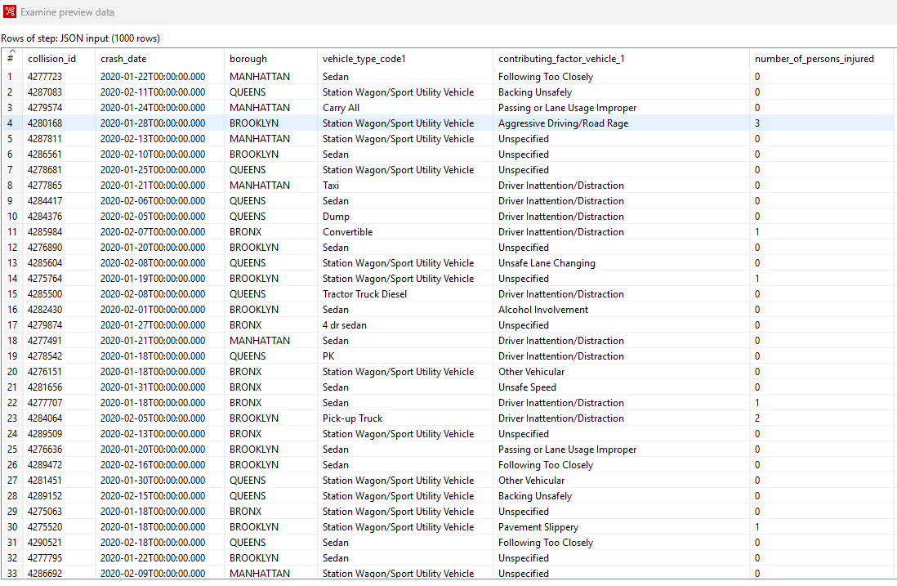
**Figura 12.** _Datos antes de la transformacion._

#### 6.2.2 JSON después
Vista previa del archivo de salida, leído de nuevo con un JSON input. Los tipos de vehículo quedan agrupados en categorías estándar: Sedan, SUV, Pickup, Camión pesado y Transporte público. Ya no aparecen registros con causa "Unspecified"; por ejemplo, el choque 4287811, que tenía causa "Unspecified", ya no está en la salida.

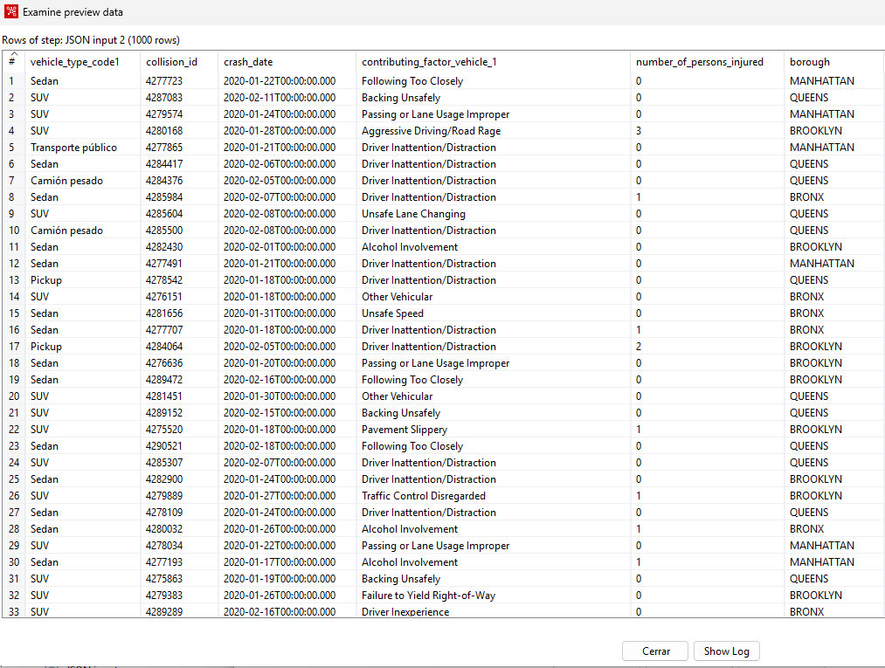
**Figura 13.** _Datos despues de la transformacion._

### 6.3 CSV
#### 6.3.1 CSV antes
Vista previa del paso de entrada con los datos originales. En `date` conviven cuatro formatos (`2026-03-14`, `03/14/2026`, `14.03.2026` y `14 March 2026`). En `amount` aparecen montos como `1,978.51` junto a otros como `6.955,90`.

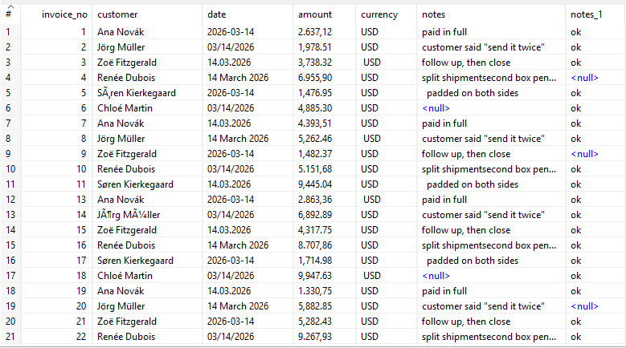
**Figura 14.** _Datos antes de la transformacion._

#### 6.3.2 CSV después
Vista previa del archivo de salida, leído nuevamente. Todas las fechas quedan en formato `2026-03-14` y todos los montos usan punto decimal y no tienen separador de miles (por ejemplo, `1978.51` y `6955.90`).

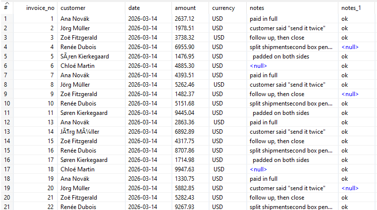
**Figura 15.** _Datos despues de la transformacion._

---

## 7. Relación con una arquitectura de Data Warehouse

<!-- Explicar cómo cada parte del proceso (fuentes, staging area, transformación, destino) se corresponde con los componentes de un Data Warehouse / Data Mart. -->

_[Completar]_

**Figura 16.** _Arquitectura de Data Warehouse y ubicación del proceso desarrollado._

---

## 8. Conclusiones

- _[Conclusión 1]_
- _[Conclusión 2]_
- _[Conclusión 3]_

---

## 9. Referencias bibliográficas

<!-- Usar norma APA 7 o IEEE de forma consistente. Citar en el texto. -->

1. _[Referencia en formato APA / IEEE]_
2. _[Referencia en formato APA / IEEE]_

---

## 10. Declaración de uso de Inteligencia Artificial

<!-- Declarar herramienta(s), para qué se usaron y el porcentaje aproximado de uso. -->

**Tabla 5.** _Declaración de uso de IA._

| Herramienta | Uso / Actividad | Sección(es) | Porcentaje aproximado |
|-------------|-----------------|-------------|-----------------------|
| _[ ]_ | _[ ]_ | _[ ]_ | _[ ]_ % |

**Porcentaje total de uso de IA en el trabajo:** _[ ]_ %

_[Declaración breve de los integrantes sobre la revisión y validación del contenido generado.]_
